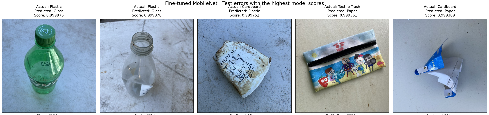

# RealWaste Image Classification

A computer vision prototype that classifies waste images into nine categories.
The project covers dataset auditing, similarity-aware splitting, CPU training,
held-out evaluation, and deployment through Streamlit and a Dockerized FastAPI
service.

## Live demo

[Open the RealWaste classifier](https://asaad-realwaste.streamlit.app/)

Upload a JPEG, PNG, or WebP image and click **Classify image** to see the
predicted category and top three model scores. The live demo currently serves
SmallCNN. The fine-tuned MobileNetV3-Small reported below was evaluated offline.

The demo runs on Streamlit Community Cloud. If the app is asleep, use the
wake-up button and allow it to start.

## Dataset and split strategy

RealWaste contains 4,752 RGB JPEG images across nine categories: Cardboard,
Food Organics, Glass, Metal, Miscellaneous Trash, Paper, Plastic, Textile Trash,
and Vegetation. Class sizes range from 318 Textile Trash images to 921 Plastic
images. Labels come from the dataset's class folders.

The audit found no unreadable images, exact file duplicates, or identical
decoded images. A difference-hash similarity check flagged 213 candidate
pairs. Visual inspection found both repeated views and false matches, so
connected candidates were conservatively assigned to the same split. The
largest group contained 84 images. These groups are based on image
similarity and may miss related images or group unrelated ones.

| Split | Images |
|---|---:|
| Training | 3,394 |
| Validation | 679 |
| Test | 679 |

All experiments use the split assignments in `reports/splits/manifest.csv`.
Validation macro F1 guided checkpoint and model selection. The test set was
opened after the final checkpoints were selected.

## Models and training

All runs used an Intel i5-13420H CPU. Training used AdamW, unweighted
cross-entropy, and ImageNet normalization. Training augmentation included
horizontal flips, small rotations, and color jitter. Validation, test, and
inference used deterministic resizing and normalization.

- **SmallCNN.** A 98,089-parameter CNN trained from scratch at 160 × 160.
  Extending the initial 12-epoch budget raised validation macro F1 from
  0.6311 to 0.6863. The extended run stopped at epoch 20 and retained epoch 14.
- **Frozen MobileNetV3-Small.** An ImageNet-pretrained feature extractor
  with a trainable nine-class classifier head. Transfer learning gave us
  pretrained visual features for a dataset with 3,394 training images and
  a CPU training budget. Inputs were resized to 224 × 224 without center
  cropping to preserve the full image. The best checkpoint was epoch 11.
- **Fine-tuned MobileNetV3-Small.** Initialized from the frozen run's best
  checkpoint. The last three feature modules were unfrozen while BatchNorm
  running statistics stayed fixed. The feature layers used a learning rate
  of 0.00006, and the classifier used 0.0003. This six-epoch run retained
  epoch 5.

Macro F1 gives each class equal weight in model selection despite differences
in class size. Configurations and run histories are under `reports/training/`.

## Results

| Checkpoint | Validation accuracy | Validation macro F1 | Test accuracy | Test macro F1 |
|---|---:|---:|---:|---:|
| SmallCNN | 69.66% | 0.6863 | 65.54% | 0.6345 |
| Frozen MobileNetV3-Small | 85.27% | 0.8530 | — | — |
| Fine-tuned MobileNetV3-Small | 86.45% | 0.8656 | 84.24% | 0.8505 |

Fine-tuning improved validation macro F1 by 1.26 percentage points over
frozen MobileNet. On the same 679 test images, the selected MobileNet
classified 572 correctly versus 445 for SmallCNN, a gain of 21.60
percentage points in macro F1.

Per-class scores, confusion matrices, and image-level predictions are under
`reports/evaluation/`.

## Error analysis

Fine-tuned MobileNet made 107 test errors. Its most frequent two-way
confusion was Metal and Plastic: 11 Metal images were predicted as Plastic,
and eight Plastic images were predicted as Metal. Miscellaneous Trash had
the lowest per-class F1 (0.767) and recall (0.718).



Two plastic bottles were predicted as Glass with softmax scores above
0.9998. Their translucency, reflections, and bottle shape are plausible
sources of ambiguity. Other errors include a printed textile pouch
predicted as Paper and torn printed cardboard packaging predicted as
Paper. These examples show why a high softmax score alone is insufficient
for automatic sorting.

A follow-up experiment would collect more examples of visually similar
containers made from different materials and test whether they reduce these
confusions on a fresh held-out set.

## Run inference locally

Run the following commands from the repository root. The bundled
`models/baseline.pt` checkpoint powers both local examples.

### Streamlit on Windows PowerShell

```powershell
python -m venv .venv
.\.venv\Scripts\python.exe -m pip install -r requirements.txt
.\.venv\Scripts\python.exe -m streamlit run streamlit_app.py
```

### FastAPI with Docker

```bash
docker build -t realwaste-api:baseline .
docker run --rm -p 8000:8000 --memory=1g --memory-swap=1g realwaste-api:baseline
```

Open `http://localhost:8000/docs` to try the API interactively.

| Endpoint | Purpose |
|---|---|
| `GET /health` | Check model readiness and version |
| `POST /predict` | Upload an image and receive the predicted category and top three scores |
| `GET /docs` | Open interactive API documentation |

The API loads the model once at startup. It accepts JPEG, PNG, and WebP
images up to 5 MiB and 12 million pixels, and rejects animated images.
It processes one prediction at a time and returns HTTP 503 when busy.
The application checks file size after multipart parsing.

To run FastAPI directly in PowerShell after installing dependencies:

```powershell
$env:MODEL_PATH = "models\baseline.pt"
.\.venv\Scripts\python.exe -m uvicorn app.main:app --host 127.0.0.1 --port 8000 --workers 1
```

All nine baseline HTTP checks passed locally and in Docker. To rerun them
with the service running and the dataset available:

```powershell
.\.venv\Scripts\python.exe -m scripts.check_api --base-url http://127.0.0.1:8000
```

## Reproduce training and evaluation

Download and extract RealWaste from [UCI](https://archive.ics.uci.edu/dataset/908/realwaste)
so the class folders are under `data/raw/realwaste-main/RealWaste/`.

```powershell
.\.venv\Scripts\python.exe -m pip install -r requirements-local.txt --extra-index-url https://download.pytorch.org/whl/cpu
.\.venv\Scripts\python.exe -m pip install -r requirements-inference.txt

.\.venv\Scripts\python.exe -m src.train --config configs/baseline_long.yaml
.\.venv\Scripts\python.exe -m src.train --config configs/mobilenet_frozen.yaml
```

Use the checkpoint path printed by the frozen run as `initial_checkpoint`
in `configs/mobilenet_finetune.yaml`, then run:

```powershell
.\.venv\Scripts\python.exe -m src.train --config configs/mobilenet_finetune.yaml
.\.venv\Scripts\python.exe -m scripts.evaluate models/baseline.pt
```

To reproduce the MobileNet evaluation, pass the fine-tuned run's selected
`best.pt` path to `scripts.evaluate` in place of `models/baseline.pt`.

To rerun data preparation, use `src.data.audit`, `src.data.review`, and
`src.data.split` in that order. Use the committed manifest for direct
comparison with the reported experiments.

## Limitations and next steps

The model assigns one of nine categories to each image. Mixed waste,
unfamiliar backgrounds, and inputs outside those categories can yield
incorrect predictions. Softmax scores are uncalibrated. Held-out results
measure performance on this RealWaste split. Performance at other
collection sites remains unmeasured.

With more compute, the next training experiment would compare gradual
unfreezing at several input resolutions and repeat runs across seeds.
Additional images from other collection sites would help test whether
improvements carry over to different backgrounds and lighting.

## Dataset attribution

RealWaste was created by Sam Single, Saeid Iranmanesh, and Raad Raad.

- [UCI dataset](https://archive.ics.uci.edu/dataset/908/realwaste)
- [Creator repository](https://github.com/sam-single/realwaste)
- [Paper](https://doi.org/10.3390/info14120633)

The creator repository lists CC BY-NC-SA 4.0, while the UCI entry lists
CC BY 4.0. Dataset figures in the reports derive from RealWaste. The
original image archive is kept outside the repository.